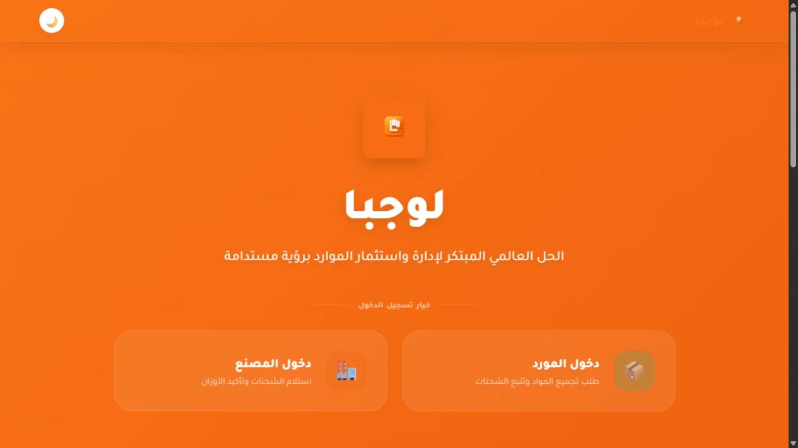

# Abathr Maged — Mobile & Full-Stack Developer

[Live portfolio](https://abathr313.github.io/abathr/) · [LinkedIn](https://www.linkedin.com/in/abathrmaged-8293a8383) · [CV](assets/documents/Abathr-Maged-CV.pdf)

I build mobile applications, web products, business systems and automation. My tools include Flutter, React Native, React, Python, Node.js, C#/.NET, Firebase and relational databases.

## Selected work

| Project | What it demonstrates | Live project |
| --- | --- | --- |
| Logba | Logistics workflows, role-based dashboards, shipment tracking and CSV export | [Open](https://logba-ded0a.web.app) |
| Rose Pharmacy | Arabic e-commerce interface, search, favourites and cart | [Open](https://rus1-fb25c.web.app) |
| Dr. Nazik Clinic | Responsive Arabic website and service presentation | [Open](https://dr-nazikclinic-cdb8b.web.app) |
| Headway English | Interactive learning, lessons, review and progress | [Open](https://headway-leth-english.web.app) |



## Certificates

Eight original certificate images are available in the [portfolio gallery](https://abathr313.github.io/abathr/#certificates), with issuer verification links extracted from the supplied CV. These are course-completion and professional-learning certificates, not university degrees. Images were extracted from the original certificate PDFs; no certificate content was generated or altered.

## Run locally

This is a static GitHub Pages site. It requires no build, framework, database or secret keys.

```sh
python -m http.server 8080
```

Open `http://localhost:8080`. Keep all file paths relative so the site works under `/abathr/`.

The contact form opens a draft in the visitor's email application. Sending happens in that application; the site does not claim to deliver messages itself.

## Structure

- `index.html`: Arabic content, selected projects, certificate cards and accessible navigation.
- `style.css`, `script.js`: original layout and navigation, with corrected contact behaviour.
- `portfolio.css`, `portfolio.js`: focused visual improvements and keyboard-accessible certificate viewer.
- `assets/certificates/`: original certificate previews.
- `assets/projects/`: actual screenshots of the featured projects.
- `assets/documents/`: downloadable CV.

Existing Android download links and additional project links are retained. This repository contains the portfolio presentation; the linked projects have their own implementations.
